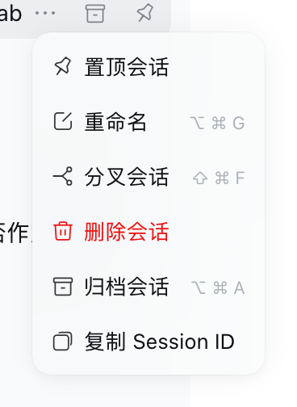
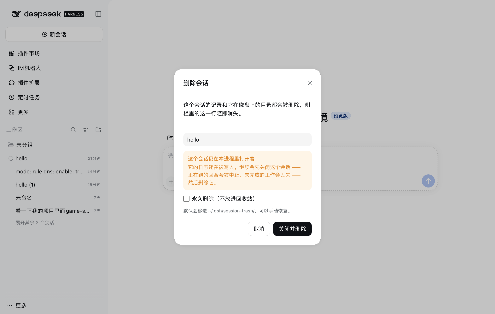
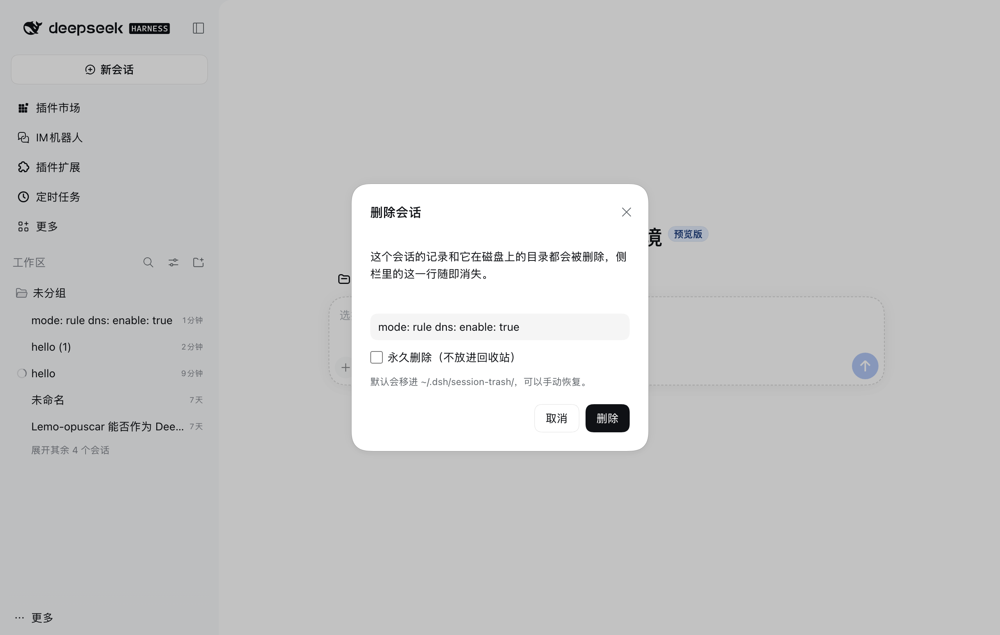

# dsh-session-cleaner

[](https://github.com/Alumos/dsh-session-cleaner/actions/workflows/ci.yml)
[](https://github.com/Alumos/dsh-session-cleaner/releases)
[](https://www.npmjs.com/package/@alumos/dsh-session-cleaner)
[](LICENSE)

在 dsh 里直接删除会话：侧栏会话菜单 →「删除会话」，会话记录、磁盘上的 `session` 目录、以及所有窗口里的那一行一起消失。



## 为什么需要它

dsh 的侧栏只有「归档」，没有删除；Host 的 `sessionPersistence` 服务也只提供
`create / open / flush / stat / list`，没有 `delete`。会话本体就是普通文件：

```
~/.dsh/sessions/<工作区编码>/session-<uuid>/session.v4.jsonl.zstd
~/.dsh/storages/session_projcache/sessions/session-<uuid>.json
```

删掉它们之后，dsh 自己的会话通道（`api-session/removed`）会让侧栏那一行消失，
不需要改动客户端列表。

## 功能

- **侧栏会话菜单**：右键会话 →「删除会话」→ 原生样式的确认对话框。
- **默认移入回收站**：`~/.dsh/session-trash/<ISO 时间戳>-<sessionId>/`，误删可手动搬回。
- **可选永久删除**：勾选对话框里的「永久删除（不放进回收站）」，或给工具传 `permanent: true`。
- **运行中的会话也能删**：第一次删除会提示它在进程里开着；按钮变成「关闭并删除」，再点一次才依次
  取消进行中的回合 → 关闭会话（`session/disposed`，持久化层关闭写句柄）→ 移入回收站。
- **顺手清理派生状态**：projcache 里该会话的 JSON、`pinned/archived` 记录、所属 Workspace 的 `sessionIds` 记账。
- **两个 Agent 工具**与**一组 HTTP 路由**复用同一套实现。





## 安装

dsh 的插件市场（设置 → 插件 → 添加插件）接受 **npm 包名、Git 仓库地址、本地目录、`.tgz` 直链** 四种来源。
**国内网络推荐方式 1（npm 包名 + 镜像）**：Git 仓库地址和 GitHub 直链都要直连 `github.com`，
npm 包的下载可以走镜像。

### 方式 1：npm 包名（推荐，可走国内镜像）

在「添加插件」里填包名：

```text
@alumos/dsh-session-cleaner
```

- 能直连 npm 官方源时，安装源选默认即可。
- 大陆网络：安装源选「自定义地址」，填 npm 镜像（例如
  `https://mirrors.huaweicloud.com/repository/npm/`；npmmirror 对带 scope 的包支持不稳定，不行就换华为云）。
- 装完在插件列表里启用。

> 注意：npm 上另有一个同名的**无 scope** 包 `dsh-session-cleaner`（由其他人发布，功能类似）。
> 本项目只发在 **`@alumos/dsh-session-cleaner`** 这个 scope 下，填错名字装到的不是这份代码。

### 方式 2：Release 里固定版本的 `.tgz` 直链

到 [Releases](https://github.com/Alumos/dsh-session-cleaner/releases) 下载，或直接填某版本的资产地址：

```text
https://github.com/Alumos/dsh-session-cleaner/releases/download/v0.2.2/dsh-session-cleaner-0.2.2.tgz
```

> 每次发版后把上面两处版本号一起改掉即可；不想手动跟版本就用下面的 nightly 固定地址。

`main` 每次提交都会自动重建一个 **nightly** 预发布，资产地址固定不变：

```text
https://github.com/Alumos/dsh-session-cleaner/releases/download/nightly/dsh-session-cleaner-nightly.tgz
```

### 方式 3：GitHub 仓库地址（需要能连 github.com）

插件市场只接受**完整地址**或 `github:` 前缀，裸 `owner/repo` 会被判为非法包名：

```text
https://github.com/Alumos/dsh-session-cleaner
github:Alumos/dsh-session-cleaner
```

> 安装时 Host 会先跑 `git ls-remote` 探活再 `git clone`，**不经过 npm 镜像**；连不上 GitHub 就会失败，
> 原始输出在 `<profile>/.plugin-manager/logs/github-connection-*/git.log`。

> **关于 `.zip`**：Release 里同时挂了源码 `.zip`，但 dsh 的安装入口只认 `.tgz` / `.tar.gz` 直链或 Git 仓库地址
> （安装规格由 `parseInstallSpec` 解析，`TARBALL_SPEC = /\.(?:tgz|tar\.gz)(?:#.*)?$/i`），**不接受 `.zip`**。

### 方式 4：本地目录

```bash
git clone https://github.com/Alumos/dsh-session-cleaner.git
```

然后在「添加插件」里填这个目录的**绝对路径**（例如 `/Users/you/dsh-session-cleaner`）。

装好后刷新窗口即可：`client.js` 走 bundle 热更新，Host 半（`index.js`）的改动在 Harness 重启/重载插件后生效。

## 使用

| 入口 | 用法 |
| --- | --- |
| 侧栏会话菜单 | 右键会话 →「删除会话」→ 确认 |
| Agent 工具 | `session_cleaner_list`（列会话拿 id）、`session_cleaner_delete`（删） |
| HTTP | `GET /dsh-session-cleaner/health`、`GET /dsh-session-cleaner/sessions`、`POST /dsh-session-cleaner/delete` |

HTTP 示例：

```bash
curl -s http://127.0.0.1:3080/dsh-session-cleaner/health
curl -s "http://127.0.0.1:3080/dsh-session-cleaner/sessions?limit=50"
curl -s -X POST http://127.0.0.1:3080/dsh-session-cleaner/delete \
  -H 'content-type: application/json' \
  -d '{"sessionId":"session-...","permanent":false}'
# 会话还开着时：加 "force": true 先关闭再删除
```

成功返回：

```json
{ "ok": true, "sessionId": "session-…", "title": "…", "cwd": "/…", "workspace": "…", "mode": "trash", "trashPath": "…", "closed": false, "removed": ["…", "…"] }
```

失败返回 `{ "ok": false, "error": { "code": "…", "message": "…" } }`。

| 错误码 | HTTP | 含义 |
| --- | --- | --- |
| `SESSION_ID_INVALID` | 400 | 不是合法的 Session id |
| `SESSION_NOT_FOUND` | 404 | 找不到对应的 session 目录 |
| `SESSION_LIVE` | 409 | 会话还开着；加 `force`（或 UI 里再点一次）先关闭 |
| `SESSION_LIVE_UNCLOSED` | 409 | 会话没能在超时内关掉（回合还在收尾），稍后重试 |
| `BODY_INVALID` / `BODY_TOO_LARGE` | 400 / 413 | 请求体不合法 / 超过 64 KiB |

## 配置

在 profile 的 `cordis.patch.yml`（或重装时的 `config`）里覆盖：

```yaml
- insert:
    - id: dsh-session-cleaner
      name: 'dsh-session-cleaner'
      config:
        basePath: /dsh-session-cleaner   # HTTP 前缀，以 / 开头、不以 / 结尾
        permanent: false                  # true = 所有删除都不进回收站
```

## 兼容性

- 开发与验证环境：dsh `0.2.1-rc.4`（DSH Tauri Nightly，macOS）。
- `package.json` 声明 `engines.dsh: ">=0.2.0-rc.1"`。
- 依赖的 Host 能力：`webServer`（HTTP 路由）、`sessions`（`get`/`remove`）、`agents`（`get().cancel`）、
  `workspaceRegistry`、`sessionPersistence.root`、`dshHomePath`（可选，缺了就退回 `$DSH_HOME` / `~/.dsh`）。
  少了 `sessions.remove` 的版本只会"关闭不了就拒绝删除"，不会误删。

### 平台

| 平台 | 状态 |
| --- | --- |
| macOS | 已在 dsh `0.2.1-rc.4` 上端到端实测（删除、回收站、运行中会话「关闭并删除」、侧栏行消失） |
| Linux | 没在真机上装过 dsh；与 macOS 同属 POSIX 路径，CI 里跑同一套离线测试 |
| Windows | 做了针对性加固，但**还没有在真 Windows + dsh 上跑过端到端**（我手上没有那台机器） |

Windows 上具体做了什么：

- 路径全部走 `node:path`；Session 根取 `sessionPersistence.root`，而 home 独立取自
  `dshHomePath()` → `$DSH_HOME` → `~/.dsh`（`sessionPersistence.root` 在 `E:` 这类另一个盘时也能算对回收站与投影缓存的位置）。
- 回收站目录名里的 `:` `.` 会被换成 `-`（Windows 文件名不允许 `:`），例如
  `%USERPROFILE%\.dsh\session-trash\2026-10-29T07-45-30-154Z-session-<id>`。
- 同一磁盘用 `fs.rename` 原子移动；跨盘时 `rename` 抛 `EXDEV`，自动降级为「复制 → 删除源目录」。
- Explorer、杀毒、索引服务会短暂占用目录，`fs.rm` / `rename` 因此可能返回 `EPERM` / `EBUSY` / `ENOTEMPTY`；
  这些错误最多退避重试 5 次（40/80/120/160 ms）才判定失败。
- `session.lock` 在 Windows 上是命名内核信号量而不是文件，所以回收站条目里可能只有 `session.v4.jsonl.zstd`，属正常。
- `windows-latest` 上跑 `npm run check` 与 `npm test`：manifest/语法校验 + 真实文件系统的删除、回收站、跨盘降级路径。

**在 Windows 上装好后验证一次**：右键一个旧会话 →「删除会话」→ 看
`%USERPROFILE%\.dsh\session-trash\` 是否出现对应目录、侧栏行是否消失；对正在运行的会话再试「关闭并删除」。
如果有任何一步失败，把 dsh 日志（`%LOCALAPPDATA%` 下对应 profile 的日志）贴到 issue，我按真实报错修。

## 目录

```
package.json          manifest（dsh.bundle / dsh.client）
cordis.patch.yml      插入 dsh-session-cleaner 插件
index.js              Host 半：路径解析、删除、Agent 工具、HTTP 路由
client.js             Client 半：侧栏菜单项 + 确认对话框
locale/{zh,en}.json   展示元数据（meta.title / meta.description）
icon.svg              图标
docs/                 截图
scripts/check.mjs     CI 用的 manifest / locale / 产物校验
tests/offline.mjs     离线行为测试（假 Cordis 上下文 + 临时 home，三平台都跑）
.github/workflows/    CI / 版本发布 / nightly
```

## 开发

```bash
node --check index.js
node --check client.js
npm pack --dry-run        # 看安装包会带哪些文件
```

安装到本地 profile 请走 dsh 的插件面板（或 `plugin_manager`），不要手改 profile 的 `package.json`、也不要手工在 profile 目录里跑 pnpm。

## 发布

- 推 `v*` tag（例如 `git tag v0.2.1 && git push origin v0.2.1`）→ `.github/workflows/release.yml` 校验 tag 与 `package.json` 版本一致，
  产出 `dsh-session-cleaner-<version>.tgz`（可直接安装）、源码 `.zip`、`SHA256SUMS.txt` 并创建 Release。
- 推 `main` → `.github/workflows/nightly.yml` 重新构建并覆盖 `nightly` 预发布里的 `dsh-session-cleaner-nightly.tgz`（版本号带 `-nightly.<日期>.<sha>`）。

## English

A dsh plugin that adds "Delete session" to the sidebar session menu: it removes the session
directory on disk (trash by default), clears its projection cache and workspace/pin/archive
bookkeeping, and broadcasts `api-session/removed` so the row disappears from every open window.
Sessions still open in the Harness get a second confirmation that cancels the running turn and
closes the session before deleting. Install it from the plugin manager using the GitHub repo
address, a release `.tgz` URL, or a local directory.

## License

[MIT](LICENSE)
